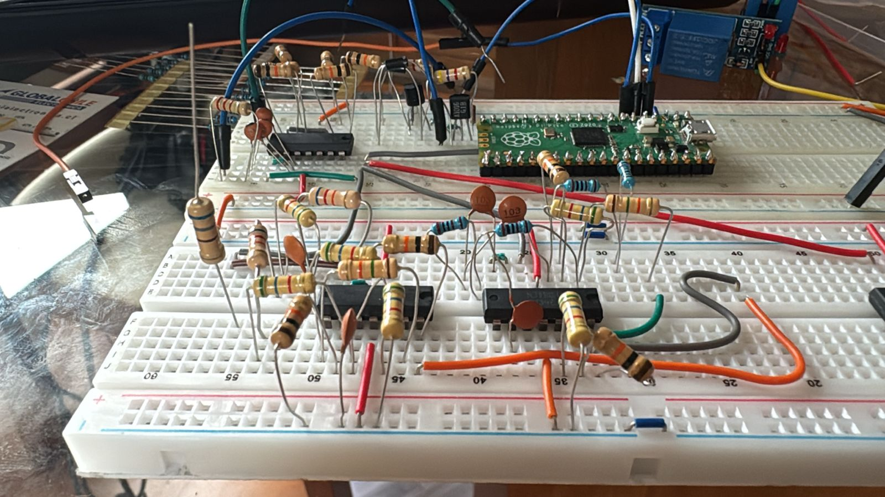
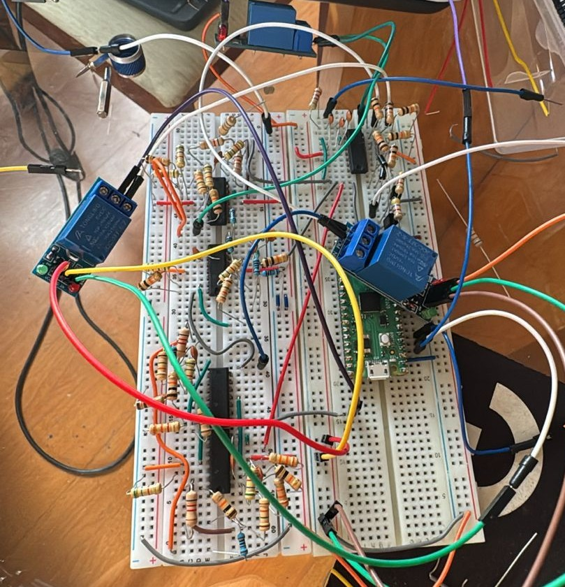

# Active Three-Band Analog Equalizer

Design, simulation, implementation and experimental characterization of an active three-band analog equalizer developed as an academic engineering project at Universidad Técnica Federico Santa María (UTFSM).

<p align="center">
  
  
</p>

## Overview

The project combines **analog electronics**, **signal processing** and **experimental validation**. The analog stage was designed and simulated as a three-band active equalizer based on operational amplifiers, then physically assembled and evaluated in the laboratory.

A MicroPython control program was also developed to sample the input signal, estimate the energy around three representative frequencies and automatically select the corresponding filter through relays.

## Frequency bands used in the control code

| Band | Representative frequency |
|---|---:|
| Low | 120 Hz |
| Mid | 1 kHz |
| High | 3 kHz |

The current implementation samples the ADC at **8 kHz** using blocks of **256 samples**. It applies the **Goertzel algorithm** to estimate the energy associated with each target frequency and changes the active relay only when the candidate band is sufficiently stronger than the currently selected band. This hysteresis-like criterion helps prevent rapid switching between relays.

## Project workflow

1. Analog circuit design.
2. Simulation of the equalizer response.
3. Physical implementation of the circuit.
4. Laboratory measurements and experimental validation.
5. Development of the automatic band-selection control code.
6. Comparison between the expected and measured system behavior.

## Technologies and tools

- Analog electronics and operational amplifiers
- Multisim
- Laboratory instrumentation
- MicroPython
- ADC signal acquisition
- Goertzel frequency analysis
- Relay control

## Repository structure

```text
analog-3-band-equalizer/
├── README.md
├── src/
│   └── main.py
├── simulation/
│   └── three-band-equalizer.ms14
├── docs/
│   ├── project-report.pdf
│   └── poster.pdf
└── images/
    ├── prototype-1.jpeg
    ├── prototype-2.jpeg
    └── prototype-3.jpeg
```

## Repository contents

- [`src/main.py`](./src/main.py) — MicroPython program for signal acquisition, frequency-energy estimation and relay selection.
- [`simulation/three-band-equalizer.ms14`](./simulation/three-band-equalizer.ms14) — Multisim project file.
- [`docs/project-report.pdf`](./docs/project-report.pdf) — project report.
- [`docs/poster.pdf`](./docs/poster.pdf) — project poster.
- [`images/`](./images) — photographs of the experimental assembly.

## Control logic

The program reads the analog signal through the ADC and evaluates three target frequency components. The strongest candidate band is compared with the currently selected one. A new relay is activated only when its estimated energy exceeds the current band's energy by a factor of **1.5**, reducing unnecessary switching.

```text
Analog input
    │
    ▼
ADC sampling
    │
    ▼
Goertzel analysis
 ┌──┼──────────────┐
 ▼  ▼              ▼
120 Hz          1 kHz          3 kHz
 Low             Mid            High
  └──────────────┬──────────────┘
                 ▼
          Band comparison
                 ▼
           Relay selection
                 ▼
          Active EQ branch
```

## Experimental implementation

The repository includes photographs of the physical prototype and the Multisim simulation file used during development. The project was implemented and evaluated through laboratory measurements after the simulation stage.

## Authors

**Paul Berdichewsky** · **Benjamín Arancibia**  
Civil Engineering in Physics students  
Universidad Técnica Federico Santa María — Santiago, Chile
