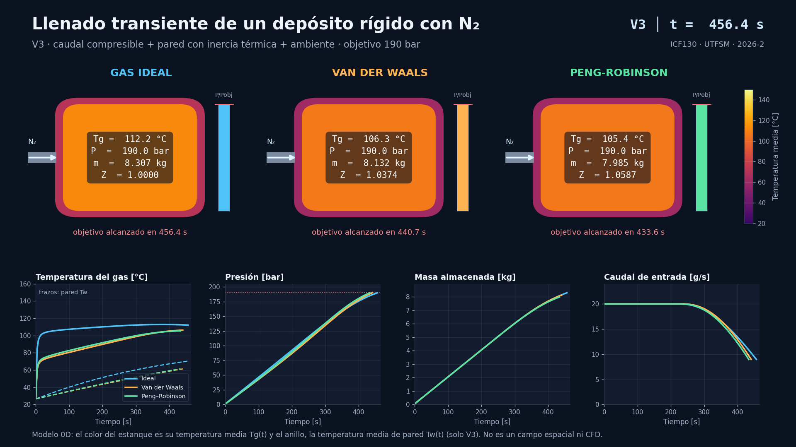

# Llenado transiente de un depósito con gas real

**Proyecto final ICF130 · Fundamentos de Termodinámica Aplicada · UTFSM (2026-2)**  
**Autores:** Paul Berdichewsky, Benjamín Arancibia y Andrés Cerón.

Simulación del llenado de un depósito rígido de 50 L con nitrógeno. Se resuelven balances transientes de masa y energía con tres ecuaciones de estado: **gas ideal, Van der Waals y Peng–Robinson**. El modelo evoluciona desde un caudal fijo (V1), a un caudal compresible variable (V2) y a una pared con inercia térmica e intercambio con el ambiente (V3).

## Acceso rápido

| Quiero… | Ir a… |
|---|---|
| **Ejecutar las simulaciones** | [codigo/](codigo/) |
| **Ver la presentación** | [entrega/](entrega/) |
| **Leer el artículo científico** | [articulo/Informe_ICF130_Formato_USM.pdf](articulo/Informe_ICF130_Formato_USM.pdf) |
| **Consultar datos, gráficos y animación** | [resultados/](resultados/) |
| **Revisar informes y material para la defensa** | [documentacion/](documentacion/) |
| **Consultar pruebas y diagnósticos** | [validacion/](validacion/) |
| **Ver las versiones originales V1–V3** | [historico/](historico/) |

## Estructura

~~~text
llenado-transiente-deposito-gas-real/
├── README.md                 # guía principal
├── codigo/                   # única copia del código final, configuración y tests
├── entrega/                  # presentación PDF y PPTX fragmentadas
├── articulo/                 # manuscrito académico, LaTeX, figuras y datos
├── resultados/               # CSV, gráficos, capturas y animación
├── documentacion/            # informe técnico, desarrollo matemático y defensa
├── validacion/               # resultados de tests, diagnósticos y registro
├── historico/                # avance original y V1, V2, V3 sin modificar
└── reconstruir_multimedia.py # recupera PDF, PPTX y MP4
~~~

## Reproducir

Se recomienda **Python 3.12 o 3.13**. Desde la raíz de este proyecto:

~~~bash
cd codigo
python -m pip install -r requirements.txt
python main.py --sin-video
python -m pytest
python main.py --caso V3 --eos pr
~~~

Las nuevas salidas de la ejecución se escriben por defecto en **codigo/resultados/**, que se ignora en Git para no mezclar resultados nuevos con los datos de referencia publicados en **resultados/**. Para animación se necesita FFmpeg; las instrucciones están en [codigo/README.md](codigo/README.md).

### Recuperar la presentación y el MP4

Por su tamaño, los archivos grandes se almacenan en partes. Desde la raíz:

~~~bash
python reconstruir_multimedia.py
~~~

El script reconstruye **Presentacion_Final.pdf**, **Presentacion_Final.pptx** y **ICF130_V1_V2_V3_tres_EOS.mp4** y comprueba su tamaño y hash SHA-256. Las piezas originales permanecen intactas.

## Criterio físico y alcance

- **V1:** llenado adiabático con caudal fijo de 20 g/s; presión objetivo histórica de 100 bar.
- **V2:** caudal compresible, con regímenes estrangulado y subsónico; presión objetivo histórica de 190 bar.
- **V3:** modelo V2 más temperatura dinámica de pared y transferencia gas–pared–ambiente, también hasta 190 bar.
- **Comparación controlada:** las diferencias entre V1 y V2 se vuelven a evaluar a **igual presión objetivo**, evitando confundir cambios de caudal con cambios de objetivo.

**Límites:** el depósito se trata como sistema concentrado (0D); la ley de caudal utiliza una aproximación isentrópica de gas ideal común a las tres EOS. Las visualizaciones no son CFD. Los parámetros térmicos/de conexión son hipótesis de estudio, no mediciones calibradas. Las pruebas y el contraste de propiedades con HEOS/Span constituyen **verificación computacional, no validación experimental**. El artículo es un manuscrito académico, no una publicación arbitrada.

La estructura organiza el proyecto; **no modifica las ecuaciones ni los resultados históricos**.
